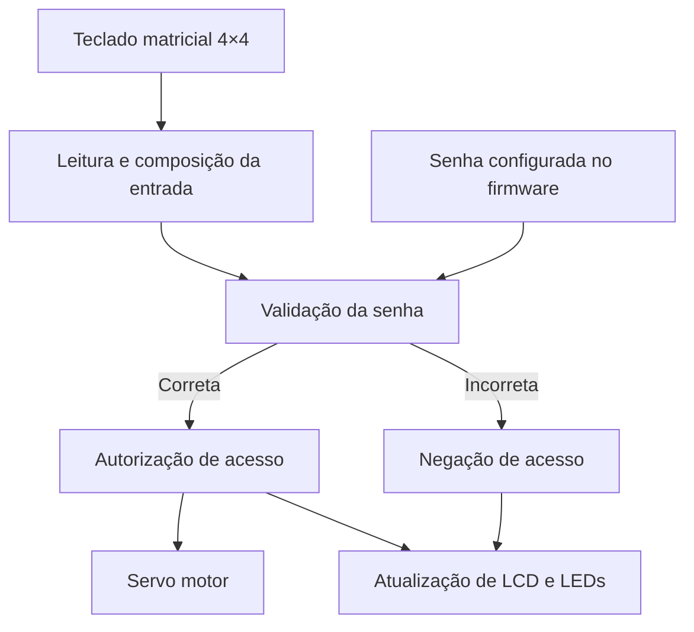

# Arquitetura do firmware — v0.1

## Visão geral

O firmware coordena a leitura do teclado, a verificação da senha e a sinalização de acesso por meio do LCD, LEDs e servo motor.



O diagrama representa a **arquitetura lógica esperada**, não uma transcrição literal das funções do código-fonte.

## Responsabilidades

### 1. Inicialização

Configura os periféricos utilizados no projeto e estabelece o estado inicial do sistema.

**Conferir no `.ino`:** bibliotecas incluídas, objetos instanciados, configuração dos pinos e comandos de inicialização executados em `setup()`.

### 2. Leitura da entrada

Recebe as teclas pressionadas no teclado 4×4 e forma a entrada que será avaliada pelo sistema.

**Conferir no `.ino`:** variável que armazena a senha digitada, tamanho máximo, tratamento de teclas especiais e condição que dispara a validação.

### 3. Autenticação

Compara a entrada recebida com a senha configurada (`1234` na versão descrita).

**Conferir no `.ino`:** local de armazenamento da senha, operador ou função de comparação e eventual tratamento de entradas incompletas.

### 4. Controle de acesso

Aciona o servo motor para representar a abertura ou o fechamento da trava conforme o resultado da autenticação.

**Conferir no `.ino`:** ângulos usados, duração da abertura e condição de retorno à posição inicial.

### 5. Interface e sinalização

Utiliza o LCD e os LEDs para informar estados e resultados ao usuário.

**Conferir no `.ino`:** mensagens exatas, cores associadas a cada estado e tempos de exibição.

## Estrutura típica de execução Arduino

```cpp
void setup() {
    // Inicialização dos componentes.
}

void loop() {
    // Leitura das teclas e processamento dos estados.
}
```

> O bloco acima é **ilustrativo**, não o código original do CyberVault. Não o copie como substituição do firmware existente.

## Mapeamento do código real (a preencher após revisão do .ino)

| Elemento | Nome no código | Responsabilidade |
| --- | --- | --- |
| Senha de referência | A verificar | Valor usado na autenticação |
| Entrada do teclado | A verificar | Acumular teclas digitadas |
| Validação | A verificar | Comparar senha digitada e referência |
| Controle do servo | A verificar | Representar a trava |
| Controle do LCD | A verificar | Exibir mensagens |
| Controle dos LEDs | A verificar | Sinalizar estados |

## Limites da arquitetura

O controle de acesso descrito é **local** ao microcontrolador. Não há evidência nesta documentação de autenticação remota, registro persistente de eventos, criptografia ou armazenamento seguro de segredos. A ausência desses recursos deve ser confirmada por inspeção do código, e não presumida apenas pelo diagrama.
