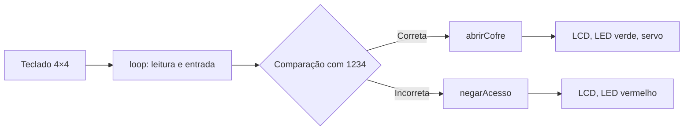

# Arquitetura do firmware — v0.1

## 1. Visão geral

O firmware executa em um único laço Arduino (`loop()`), sem sistema operacional ou tarefas paralelas explícitas. Ele recebe teclas, acumula até quatro dígitos, compara a entrada com uma senha fixa e atualiza LCD, LEDs e servomotor.

A comparação só acontece ao pressionar `#`; a digitação de quatro caracteres, isoladamente, **não** confirma a senha.

## 2. Bibliotecas e objetos

| Trecho | Explicação |
| --- | --- |
| `#include <Keypad.h>` | Disponibiliza a leitura do teclado matricial. |
| `#include <LiquidCrystal.h>` | Disponibiliza a interface do LCD. |
| `#include <Servo.h>` | Disponibiliza o controle do servomotor. |
| `LiquidCrystal lcd(10, 11, A0, A1, A2, A3);` | Configura os seis pinos Arduino usados pelo LCD, na ordem RS, Enable, D4, D5, D6 e D7 da interface. |
| `Keypad teclado = Keypad(...)` | Associa mapa de caracteres, pinos de linhas/colunas e dimensões do teclado. |
| `Servo trava;` | Instancia o objeto que controla a trava simulada. |

## 3. Constantes e estado

| Nome | Tipo/valor | Função |
| --- | --- | --- |
| `LINHAS`, `COLUNAS` | `const byte = 4` | Dimensões do teclado. |
| `teclas` | `char[4][4]` | Mapa dos caracteres de cada tecla. |
| `pinosLinhas` | `{2, 3, 4, 5}` | Pinos Arduino conectados às linhas. |
| `pinosColunas` | `{6, 7, 8, 9}` | Pinos Arduino conectados às colunas. |
| `PINO_SERVO` | `12` | Pino de controle do servo. |
| `LED_VERDE` | `A4` | Saída do indicador de sucesso. |
| `LED_VERMELHO` | `A5` | Saída do indicador de falha. |
| `SENHA_CORRETA` | `const String = "1234"` | Credencial fixa embutida no firmware. |
| `senhaDigitada` | `String = ""` | Entrada acumulada durante a sessão de digitação. |

O código usa `String` para guardar e comparar a senha. Não há armazenamento não volátil, hash de senha ou configuração de credencial no trecho fornecido.

## 4. Funções

### `mostrarTelaInicial()`

1. `lcd.clear()` apaga o conteúdo anterior.
2. `lcd.setCursor(0, 0)` seleciona a primeira linha e imprime `CYBERVAULT`.
3. `lcd.setCursor(0, 1)` seleciona a segunda linha e imprime `Senha: `.

### `fecharCofre()`

- `trava.write(0)` comanda o servo para 0°.
- `digitalWrite(..., LOW)` apaga os dois LEDs.
- `Serial.println("Cofre fechado")` envia uma mensagem pela serial.

A posição 0° representa o estado fechado **na lógica do protótipo**; a posição mecânica real depende da montagem.

### `abrirCofre()`

1. Limpa o LCD e imprime `ACESSO PERMITIDO`.
2. Acende o LED verde e apaga o vermelho.
3. `trava.write(90)` comanda a posição aberta.
4. Escreve `Cofre aberto` na serial.
5. `delay(5000)` espera aproximadamente cinco segundos, bloqueando o fluxo normal do `loop()`.
6. Chama `fecharCofre()` para comandar 0° e apagar os LEDs.

### `negarAcesso()`

1. Limpa o LCD e imprime `ACESSO NEGADO`.
2. Acende o LED vermelho e apaga o verde.
3. Escreve `Senha incorreta` na serial.
4. `delay(2000)` espera aproximadamente dois segundos.
5. Apaga o LED vermelho.

Esta função não move o servo e não incrementa contador de erros.

### `setup()`

Executado uma vez na inicialização:

1. `Serial.begin(9600)` inicia a serial.
2. `lcd.begin(16, 2)` inicializa o LCD.
3. Configura os dois LEDs como saídas.
4. `trava.attach(PINO_SERVO)` associa o servo ao pino 12.
5. `fecharCofre()` estabelece o estado inicial fechado.
6. `mostrarTelaInicial()` apresenta o prompt de senha.

### `loop()`

- `teclado.getKey()` consulta a tecla pressionada.
- Se `tecla == NO_KEY`, retorna imediatamente desta iteração.
- Para dígitos `0` a `9`, acrescenta o caractere a `senhaDigitada` **apenas se** seu comprimento for menor que 4.
- Depois de aceitar um dígito, posiciona o cursor em `7 + senhaDigitada.length() - 1`, na segunda linha, e imprime `*`. Assim, os quatro asteriscos ocupam as colunas 7 a 10.
- `*` redefine `senhaDigitada = ""` e restaura a tela inicial.
- `#` compara `senhaDigitada == SENHA_CORRETA`; chama `abrirCofre()` ou `negarAcesso()` e, ao final, limpa a entrada e restaura a tela.
- `A`, `B`, `C` e `D` são lidas, mas ignoradas pela lógica.

As três condições (`if`) são independentes, mas os conjuntos de teclas tratados não se sobrepõem.

## 5. Considerações de execução

- Os `delay(5000)` e `delay(2000)` são bloqueantes: enquanto executados, o firmware não volta a consultar `teclado.getKey()`.
- O firmware não utiliza interrupções para ler o teclado nem uma máquina de estados explícita.
- A entrada digitada é mantida em RAM e apagada após `*` ou `#`.
- As mensagens seriais informam resultados, mas não registram horário, número de tentativas ou identificador de usuário.
- O código não contém mecanismo para atualizar a senha em tempo de execução.

## 6. Referência

Análise baseada exclusivamente no sketch Arduino da v0.1 fornecido para este projeto. O código original deve ser mantido versionado separadamente desta documentação.
