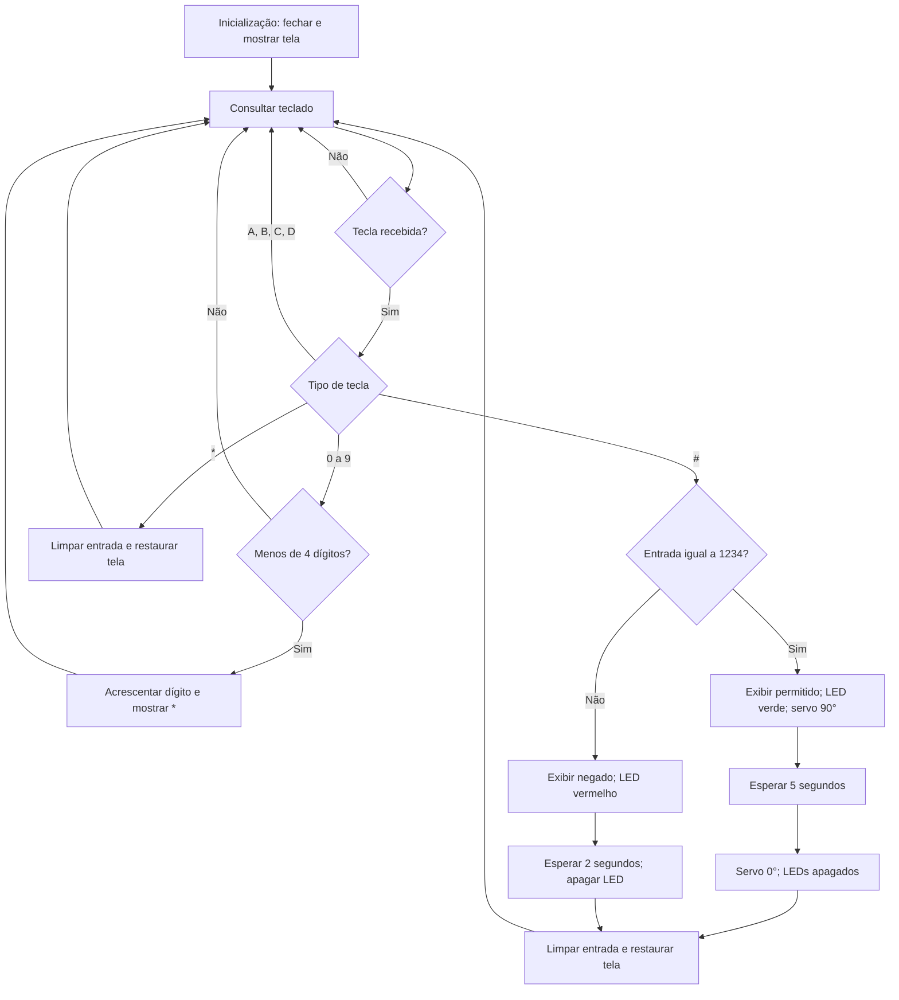

# Fluxo de autenticação — v0.1

## 1. Fluxograma

## 2. Exemplo: acesso autorizado

1. O LCD mostra `CYBERVAULT` e `Senha: `.
2. O usuário pressiona `1`, `2`, `3`, `4`.
3. O LCD mostra `Senha: ****`; a senha real permanece em `senhaDigitada`.
4. O usuário pressiona `#`.
5. O código compara `"1234" == "1234"`.
6. O LCD mostra `ACESSO PERMITIDO`, o LED verde acende e o servo recebe o comando 90°.
7. Após 5 segundos, o servo recebe 0°, os LEDs apagam e a tela inicial retorna.

## 3. Exemplo: acesso negado

1. O usuário digita `0000` e pressiona `#`.
2. A comparação com `1234` falha.
3. O LCD mostra `ACESSO NEGADO`; o LED vermelho acende por 2 segundos.
4. A entrada é limpa e a tela inicial retorna, **sem bloqueio por tentativas anteriores**.

## 4. Casos de teste para reprodução no Tinkercad

Os resultados abaixo são **esperados pela leitura do código**; devem ser confirmados e registrados na simulação.

| ID | Entrada | Resultado esperado |
| --- | --- | --- |
| AUTH-01 | `1234#` | Acesso permitido; servo 90° por cerca de 5 s e depois 0°. |
| AUTH-02 | `0000#` | Acesso negado; LED vermelho por cerca de 2 s. |
| AUTH-03 | `12*1234#` | `*` limpa a entrada; a senha posterior é aceita. |
| AUTH-04 | `12345#` | O quinto dígito é ignorado; a entrada `1234` é aceita. |
| AUTH-05 | `#` sem dígitos | Acesso negado, pois `"" != "1234"`. |
| AUTH-06 | `12#` | Acesso negado. |
| AUTH-07 | `A`, `B`, `C` ou `D` | Nenhuma ação de autenticação ou atualização de LCD. |
| AUTH-08 | `0000#` repetido | Cada tentativa é negada, sem contador ou bloqueio. |

## 5. Evidências recomendadas

- Captura do LCD antes da digitação.
- Captura de `Senha: ****` antes de pressionar `#`.
- Captura do estado de acesso permitido (LCD, servo e LED verde).
- Captura do estado de acesso negado (LCD e LED vermelho).
- Registro das mensagens seriais correspondentes.
- Vídeo curto ou sequência de capturas de tentativas incorretas repetidas para o experimento CV-01.

Nomeie evidências com IDs dos testes, por exemplo `auth-01-access-granted.png`. Não inclua credenciais novas ou segredos reais nas capturas.

## 6. Limites da validação

O firmware não mede duração real da movimentação mecânica do servo; `delay(5000)` define a espera após o comando. Os testes devem diferenciar comportamento esperado pelo código de comportamento observado na simulação.
