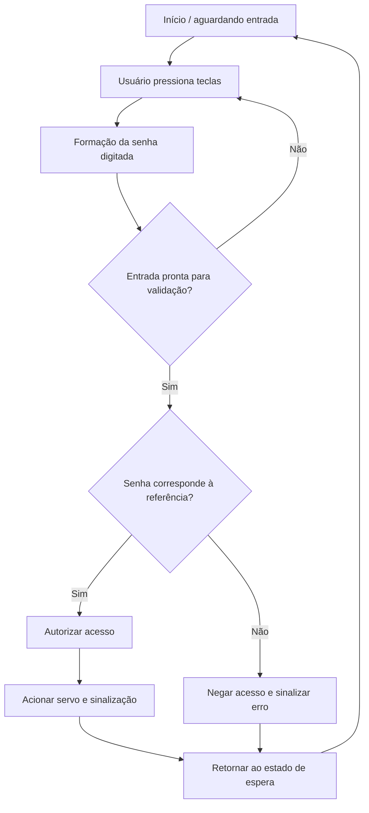

# Fluxo de autenticação — CyberVault v0.1

## Objetivo

Descrever como o sistema recebe uma senha e decide se deve liberar a trava representada pelo servo motor.

## Fluxo lógico

Este fluxograma é **conceitual**. A maneira exata como a entrada é concluída e como o sistema retorna à espera depende do código-fonte.

## Cenário A — Senha correta

**Pré-condição:** sistema inicializado e pronto para receber teclas.

1. O usuário informa a senha configurada no protótipo: `1234`.
2. O firmware compara a entrada com a senha de referência.
3. A comparação resulta em autorização.
4. O servo representa a abertura da trava.
5. LCD e LEDs sinalizam o resultado, conforme a implementação.

**Resultado esperado:** acesso autorizado.

## Cenário B — Senha incorreta

1. O usuário informa uma combinação diferente da senha de referência.
2. O firmware realiza a comparação.
3. A comparação resulta em negação.
4. A trava não deve ser liberada.
5. LCD e LEDs sinalizam a falha, conforme a implementação.

**Resultado esperado:** acesso negado.

## Cenário C — Tentativas repetidas

Este cenário prepara o experimento CV-01.

1. Informar uma senha incorreta.
2. Observar a resposta do sistema.
3. Repetir o processo várias vezes no simulador.
4. Registrar se existe contador de falhas, atraso progressivo ou bloqueio temporário.

**Hipótese da v0.1:** o firmware permite tentativas sucessivas sem limite. **Confirmar em teste antes de registrar como resultado observado.**

## Casos de teste

| ID | Entrada / ação | Resultado esperado | Resultado observado |
| --- | --- | --- | --- |
| AUTH-01 | Digitar `1234` | Acesso autorizado | Pendente de evidência |
| AUTH-02 | Digitar senha diferente de `1234` | Acesso negado | Pendente de evidência |
| AUTH-03 | Repetir senhas incorretas | Verificar se há bloqueio | Pendente de teste |
| AUTH-04 | Digitar entrada incompleta | Registrar comportamento real | Pendente de teste |
| AUTH-05 | Usar teclas especiais | Registrar comportamento real | Pendente de teste |

## Evidências sugeridas

Armazenar imagens ou vídeos em `assets/screenshots/` e referenciá-los nesta página após a execução dos testes. Não registrar um resultado como comprovado sem evidência correspondente.
