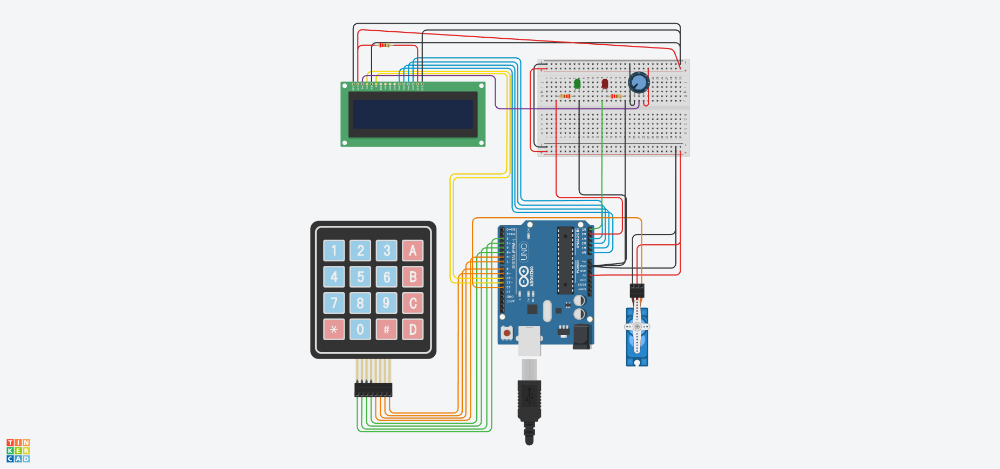

# Montagem e verificação do circuito — CyberVault v0.1

## Pré-requisitos

- Abrir o Tinkercad Circuits e criar ou duplicar um circuito.
- Selecionar Arduino Uno R3, protoboard, teclado 4×4, LCD 16×2, potenciômetro 10 kΩ, micro servo, dois LEDs, três resistores de 220 Ω e fios.
- Usar o [mapa de conexões](wiring.md) como fonte de referência, conferindo os nomes dos pinos no simulador.

## Etapa 1 — Alimentação

1. Conecte `5V` do Arduino ao barramento positivo (`+`) da protoboard.
2. Conecte `GND` ao barramento negativo (`−`).
3. Una os barramentos superior/inferior que serão usados, sem ligar positivo a negativo.

**Verificação:** todos os componentes devem compartilhar a mesma referência GND.

## Etapa 2 — Teclado 4×4

1. Identifique R1–R4 e C1–C4 no teclado.
2. Ligue as linhas a D2–D5 e as colunas a D6–D9.
3. Execute um teste de leitura de teclas no Monitor Serial antes de avançar.

**Verificação:** as teclas pressionadas são identificadas corretamente, inclusive `*` e `#`.

## Etapa 3 — LCD e contraste

1. Alimente VSS e VDD com GND e 5 V.
2. Conecte os extremos do potenciômetro a 5 V e GND e o cursor a VO.
3. Ligue RS em D10, RW em GND e E em D11.
4. Ligue LCD D4–D7 aos pinos A0–A3 do Arduino, nessa ordem.
5. Deixe LCD D0–D3 sem conexão.
6. Ligue LED+ a 5 V por resistor de 220 Ω e LED− a GND.

**Verificação:** execute um programa simples que mostre `CYBERVAULT` e `Sistema pronto`; ajuste o potenciômetro até o texto ficar legível.

## Etapa 4 — Servo

1. Ligue o terminal de sinal do servo ao D12.
2. Ligue alimentação ao 5 V e terra ao GND comum.
3. No teste de firmware, solicite 0° e 90°.

**Verificação:** o servo vai para as posições simuladas de fechado e aberto.

## Etapa 5 — LEDs

1. Monte o LED verde com um resistor de 220 Ω em série entre A4 e o ânodo; ligue o cátodo a GND.
2. Repita com o LED vermelho usando A5.
3. Observe a polaridade de cada LED.

**Verificação:** senha correta acende verde; incorreta acende vermelho.

## Etapa 6 — Teste integrado da v0.1

Use o firmware funcional já testado no Tinkercad e confirme:

| Ação | Resultado esperado |
|---|---|
| Iniciar simulação | LCD solicita a senha; servo fechado |
| Digitar `1234#` | acesso permitido; servo vai a 90°; LED verde acende |
| Aguardar ~5 segundos | servo retorna a 0° e indicação volta ao estado inicial |
| Digitar `9999#` | acesso negado; servo permanece fechado; LED vermelho acende temporariamente |
| Pressionar `*` enquanto digita | entrada de senha é limpa |

**Observação:** a senha `1234` e os tempos acima correspondem ao firmware didático atual, não a um padrão de segurança recomendado. O detalhamento do código e os resultados de teste serão mantidos na futura documentação de firmware.

## Evidência da montagem

**Estado da imagem:** circuito montado, com LCD sem texto exibido no instante da captura. Esta imagem **não comprova individualmente todos os testes funcionais**; os resultados devem ser registrados separadamente quando capturados.

## Próximos registros recomendados

- Captura com `ACESSO PERMITIDO` e servo aberto.
- Captura com `ACESSO NEGADO` e LED vermelho aceso.
- Link compartilhável do circuito Tinkercad (quando disponível).
