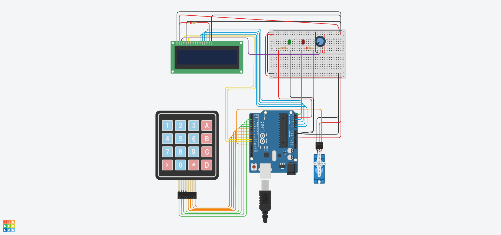

# Mapa de conexões — CyberVault v0.1

Esta tabela registra o **mapeamento usado no código que foi testado** e a montagem apresentada na [captura do circuito](../assets/screenshots/circuit-overview.png). Alguns contatos são pequenos na imagem; ao reproduzir, confirme o nome de cada terminal no editor do Tinkercad. Não trate a cor de um fio como prova de seu destino elétrico.

## 1. Alimentação e protoboard

| Origem | Destino | Finalidade |
|---|---|---|
| Arduino `5V` | barramento `+` da protoboard | distribuir 5 V |
| Arduino `GND` | barramento `−` | referência comum |
| Barramento superior `+` | barramento inferior `+` | continuidade de 5 V |
| Barramento superior `−` | barramento inferior `−` | continuidade do GND |

As duas metades de cada barramento, se interrompidas, devem ser unidas quando usadas. Na captura há jumpers conectando barramentos.

## 2. Teclado matricial 4×4

| Terminal lógico | Arduino |
|---|---|
| R1 | D2 |
| R2 | D3 |
| R3 | D4 |
| R4 | D5 |
| C1 | D6 |
| C2 | D7 |
| C3 | D8 |
| C4 | D9 |

> O teclado usa **oito conexões**, sem necessidade de um fio dedicado de 5 V/GND no esquema de varredura utilizado. Verifique a ordem física R1–R4/C1–C4 no Tinkercad: ela pode diferir do posicionamento visual dos cabos.

## 3. LCD 16×2 — modo de 4 bits

| Nº | Nome do terminal LCD | Destino |
|---:|---|---|
| 1 | VSS | GND |
| 2 | VDD | 5 V |
| 3 | VO | terminal central do potenciômetro |
| 4 | RS | Arduino D10 |
| 5 | RW | GND |
| 6 | E | Arduino D11 |
| 7 | D0 | sem conexão |
| 8 | D1 | sem conexão |
| 9 | D2 | sem conexão |
| 10 | D3 | sem conexão |
| 11 | D4 | Arduino A0 |
| 12 | D5 | Arduino A1 |
| 13 | D6 | Arduino A2 |
| 14 | D7 | Arduino A3 |
| 15 | LED+ / A | 5 V **via resistor de 220 Ω em série** |
| 16 | LED− / K | GND |

**Atenção:** `D4–D7` na coluna do LCD são **nomes de terminais do display**, não os pinos `D4–D7` do Arduino. Nesta montagem, os dados do LCD vão para `A0–A3`.

## 4. Potenciômetro de 10 kΩ

| Terminal | Destino |
|---|---|
| Externo 1 | GND |
| Central (cursor) | LCD VO (pino 3) |
| Externo 2 | 5 V |

## 5. Micro servo

| Terminal | Destino |
|---|---|
| Sinal | Arduino D12 |
| Alimentação | 5 V |
| GND | GND comum |

O **servo não usa o pino D12 para alimentação**; D12 envia apenas o sinal de comando.

## 6. LEDs de status

| Componente | Caminho elétrico |
|---|---|
| Verde | Arduino A4 → resistor 220 Ω → ânodo (+) do LED → cátodo (−) → GND |
| Vermelho | Arduino A5 → resistor 220 Ω → ânodo (+) do LED → cátodo (−) → GND |

A posição do resistor em série pode ser antes ou depois do LED, mantendo o mesmo caminho de corrente.

## 7. Resumo dos pinos do Arduino

| Pinos | Uso |
|---|---|
| D0 e D1 | livres; comunicação serial USB |
| D2–D5 | linhas do teclado |
| D6–D9 | colunas do teclado |
| D10 | LCD RS |
| D11 | LCD E |
| D12 | sinal do servo |
| D13 | livre na v0.1 (reservado para expansão) |
| A0–A3 | dados D4–D7 do LCD |
| A4 | LED verde |
| A5 | LED vermelho |

## 8. Cuidados elétricos

1. Desligue a simulação antes de alterar fios.
2. Verifique curtos entre `5V` e `GND` e a polaridade dos LEDs.
3. Confirme que os resistores estejam em **série** com as cargas indicadas.
4. Não deduza conectividade apenas por proximidade de fios na imagem; o que importa é o nó elétrico do Tinkercad.
5. Em hardware real, um micro servo pode exigir fonte externa adequada, mantendo GND comum com o Arduino.

## Imagem de referência

